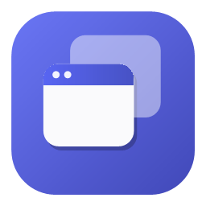
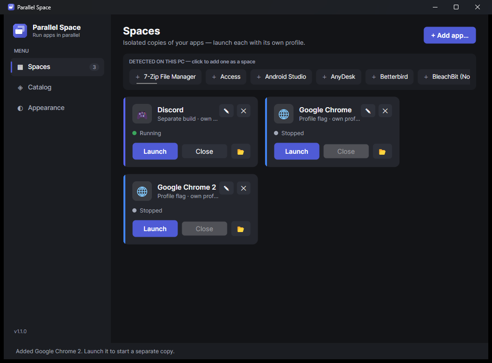
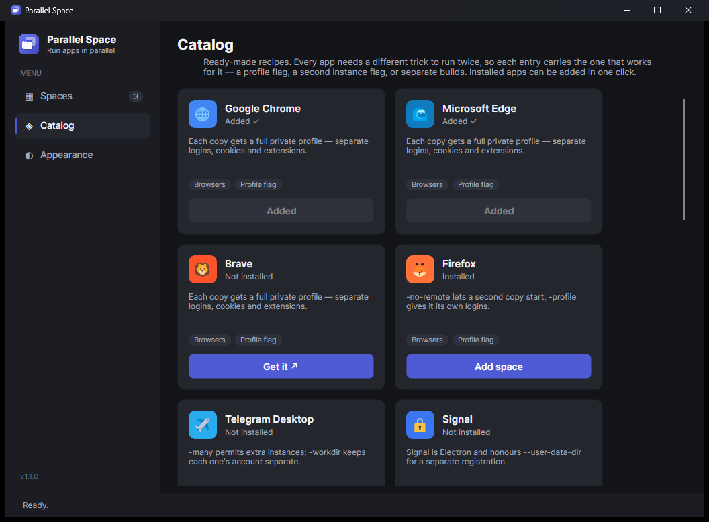
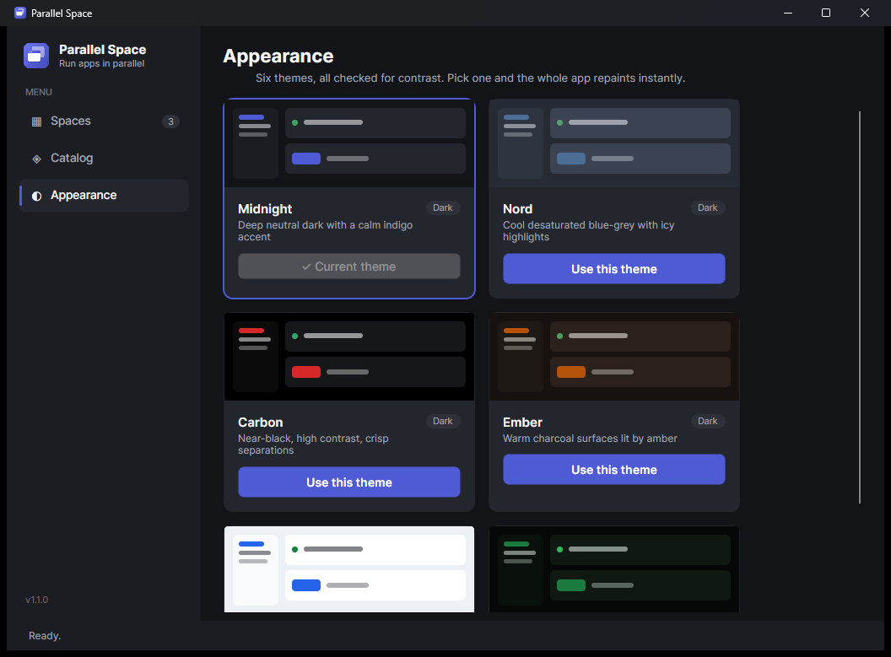
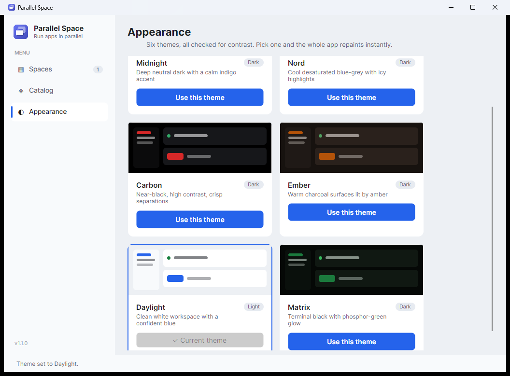

<div align="center">



# Parallel Space

**Run isolated, parallel copies of any Windows app — so you can be signed into
several accounts at once.**

Two Chrome profiles. Three Telegram accounts. A work Slack and a client Slack.
Each copy gets its own profile, so each one is a separate login.

[](https://github.com/dboudreau00/ParallelSpace/actions/workflows/build.yml)

-4F5BD5)




</div>

---

## Why it isn't just "run the exe twice"

Most desktop apps refuse to start twice, and keep exactly one login folder — so a
second launch just focuses the first window. Getting a genuinely separate second
copy needs a different trick **per app**, and that is the whole idea here:

| Technique | How it works | Apps |
|---|---|---|
| **Profile flag** | The app takes a flag that relocates its entire profile. Most reliable. | Chrome, Edge, Brave, Firefox, Signal, Element, Slack, VS Code, Obsidian, qBittorrent, Thunderbird |
| **Multi-instance flag** | A flag permits a second instance, plus one for its data. | Telegram Desktop |
| **Separate builds** | The vendor ships parallel builds that each keep their own account. | Discord Stable / PTB / Canary |
| **Isolated profile** | No flag — the copy is launched with its environment redirected into a private folder. | Portable apps and anything you add yourself |

Parallel Space keeps a **catalog** of these recipes, detects which of them you have
installed, and adds them as one-click "spaces". Anything not in the catalog you can
add yourself and pick the technique.

> **The honest caveat.** The isolated-profile fallback cannot separate accounts for
> apps that resolve their data folder through the Windows known-folder API rather
> than the environment — Discord is the notable one, which is exactly why it uses
> separate builds instead. Recipes in the catalog say which technique they use so
> you always know what you are getting.

---

## What's in it

<table>
<tr>
<td width="50%"><br/><sub><b>Catalog</b> — ready-made recipes, with installed apps detected</sub></td>
<td width="50%"><br/><sub><b>Appearance</b> — six themes, switched live</sub></td>
</tr>
</table>

- 🗂️ **Spaces** — each an isolated copy with **Launch / Close**, a live status dot,
  and its own data folder.
- ◈ **Catalog** — 15 recipes covering browsers, chat, mail and tools.
- 🔍 **Detected on this PC** — a quick-add strip built from your Start Menu.
- ✏️ **Full editor** — name, program, arguments, working folder, isolation, icon and
  colour. `{DATA}` in the arguments means "this space's private folder".
- ◐ **Six themes** — Midnight, Nord, Carbon, Ember, Daylight (light) and Matrix.
  Every palette is contrast-checked: primary text ≥ 7:1 on every surface, secondary
  ≥ 4.5:1, white on accent ≥ 4.5:1.
- 📦 **Zero install** — one self-contained `.exe`. No .NET runtime, no admin rights.

<div align="center">

<br/><sub>The same app in <b>Daylight</b> — themes repaint everything, including the dialogs</sub>
</div>

---

## Download

1. Grab **`ParallelSpace-v1.1.0-win-x64.zip`** from
   [**Releases**](https://github.com/dboudreau00/ParallelSpace/releases/latest).
2. Unzip and run **`ParallelSpace.exe`**.

Windows 10/11 (x64). The build isn't code-signed, so SmartScreen may warn on first
run — choose **More info → Run anyway**.

---

## Using it

**Catalog → Add space** on anything marked *Installed*, then **Launch** it from
Spaces. For a second account, add the same app again — the button becomes **Add
another** — which creates a second space with its own private folder. Launch both
and sign each into a different account.

(Adding it twice is what gives you two profiles. Pressing Launch twice on *one*
space just reuses that space's folder, so the app's own single-instance handling
takes over.)

For an app that isn't in the catalog, **+ Add app…** on the Spaces page, or click it
in the *Detected on this PC* strip. Choose **Isolated profile** unless the app has
its own profile flag — if it does, put the flag in Arguments and use `{DATA}`:

```
--user-data-dir="{DATA}"
```

**For several Discord accounts:** add *Discord*, *Discord PTB* and *Discord Canary*
from the catalog. They are separate installs with separate data folders, which is
what gives each one its own account — no patching involved.

Spaces are saved to `%APPDATA%\ParallelSpace\spaces.json`, and each space's data
lives under `%APPDATA%\ParallelSpace\Spaces\<id>`. Closing the manager leaves your
launched apps running.

---

## How a launch works

Each launch is created **suspended**, put into its own **Windows job object**, and
then resumed. That ordering matters: many apps start through a stub that spawns the
real process and exits immediately (Squirrel/Electron updaters, Store app stubs), and
anything that assigns the job *after* starting the process loses that race — the real
app escapes the job, the space reports "Stopped", and Close does nothing.

Because each copy has its own job, **Close** terminates that copy's whole process
tree and nothing outside it. The job carries no kill-on-close limit, so quitting
Parallel Space leaves your apps running.

**One exception:** Discord channel spaces are tracked and closed by process image
name, because a channel is a single install that may already be running from
outside Parallel Space. Closing one ends every running copy of that channel.

---

## Build from source

Requires the **.NET 9 SDK**.

```powershell
git clone https://github.com/dboudreau00/ParallelSpace.git
cd ParallelSpace

powershell -ExecutionPolicy Bypass -File tools/run.ps1       # build + run
powershell -ExecutionPolicy Bypass -File tools/build.ps1     # build Release
powershell -ExecutionPolicy Bypass -File tools/package.ps1   # zip a release into dist/
```

Adding an app to the catalog is a few lines — see [CONTRIBUTING.md](CONTRIBUTING.md).

---

## Project structure

```
src/ParallelSpace/
  Assets/        appicon.ico, logo.png (generated by tools/IconGen)
  Models/        Space, AppPreset, AppTheme, IsolationMode
  Services/
    AppCatalog.cs        the app recipes + installed-app detection
    DiscordDetector.cs   the three Discord release channels
    Launcher.cs          exe resolution, {DATA}, isolation, job tracking, close
    JobObject.cs         Windows job object wrapper
    ProcessStarter.cs    CreateProcess suspended -> assign to job -> resume
    SpaceStore.cs        spaces.json (atomic) + per-space data folders
    AppScanner.cs        Start Menu shortcuts -> detected apps
    ThemeManager.cs      applies a theme to the live resource dictionary
  ViewModels/    MainWindow, Space, EditSpace, CatalogItem, ThemeOption
  Views/         MainWindow, EditSpaceWindow (Avalonia XAML)
tools/
  IconGen/       draws the app icon + logo
  Harness/       headless check of the service layer
  StubApp/       test fixture: a launcher stub that spawns a child and exits
  build.ps1 / run.ps1 / package.ps1
```

## Tech

C# / .NET 9, **Avalonia 11** with MVVM (CommunityToolkit.Mvvm). No admin rights;
everything runs as the current user. The theme palettes were designed in
[Magic Patterns](https://www.magicpatterns.com/) and verified against WCAG.

## Limitations

- Windows only (x64).
- The isolated-profile fallback can't split accounts for apps that read their data
  folder from the Windows known-folder API (see the caveat above).
- Not code-signed, so expect a SmartScreen prompt on first run.

## License

[MIT](LICENSE).
